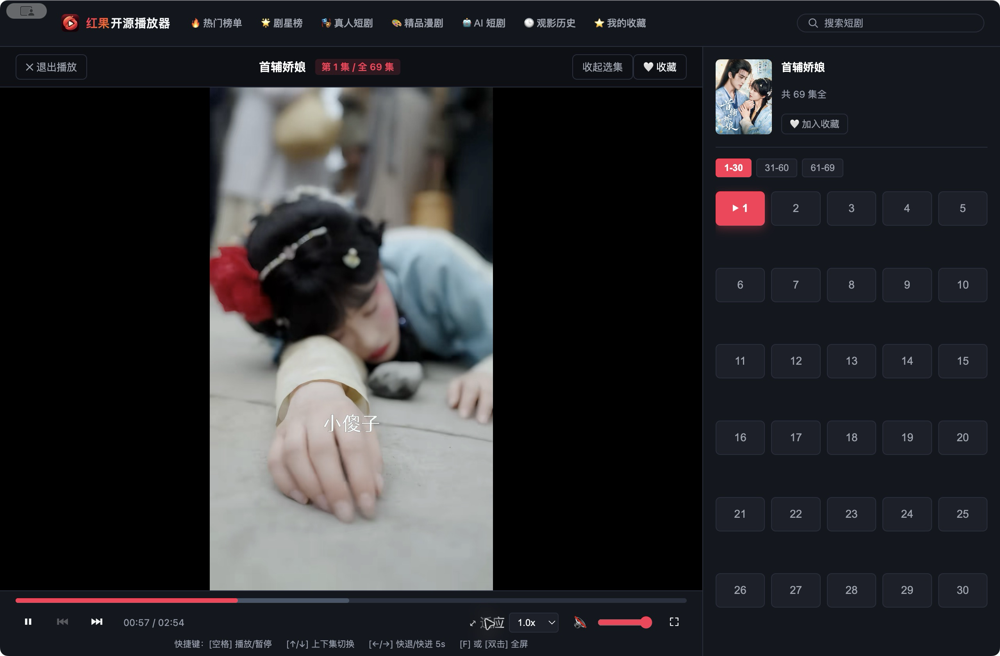
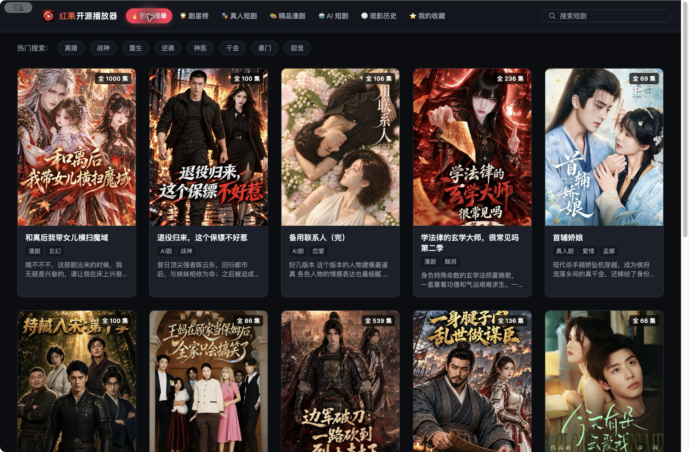
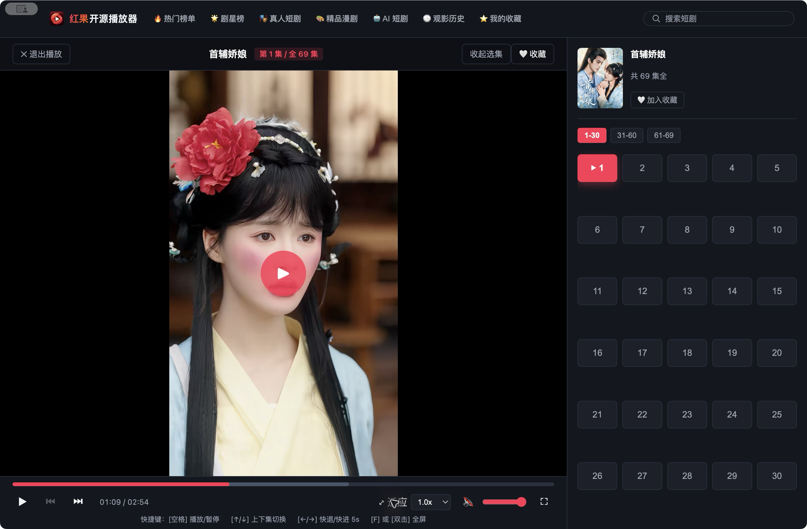
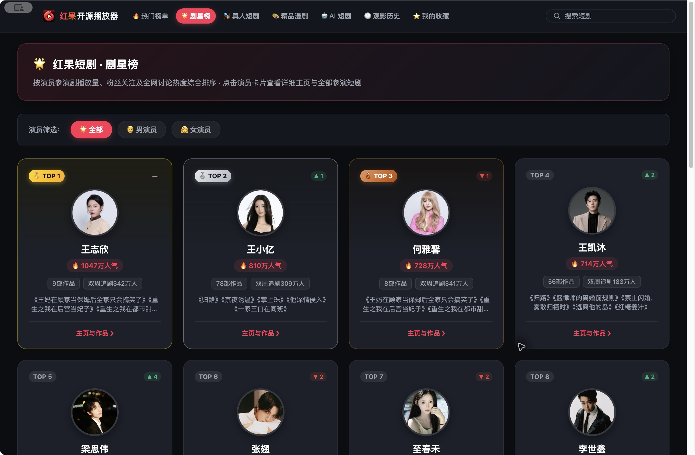
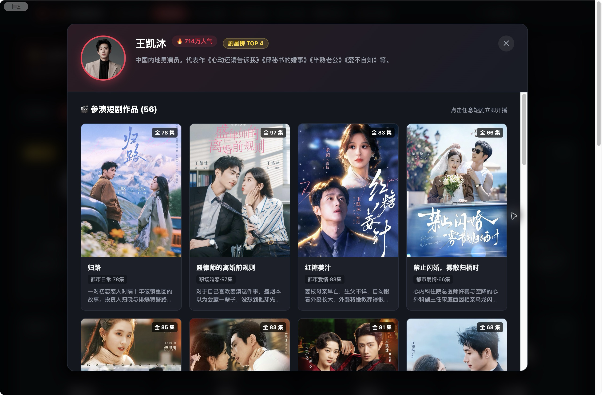

# 红果开源播放器 (Hongguo Open Player)

一款红果短剧跨平台桌面播放客户端（支持 macOS 与 Windows）。无需安装安卓模拟器，内置流媒体解密与本地代理，提供剧目检索、演员与作品浏览、沉浸式观影和本地进度记忆。

---

## 📸 界面预览 (Screenshots)

### 沉浸式影院播放（自适应画幅与选集列表）

按视频画幅适配播放区域，侧栏展示分集；顶部保留剧目分类、剧星榜及搜索入口。

### 热门短剧目录、分类与剧星榜入口

通过顶部导航切换短剧分类或进入「剧星榜」。搜索框空闲时隐藏搜索按钮，聚焦后显示按钮；输入关键词后可点击搜索或按回车提交。

### 快捷键操作与播放控制反馈

播放控制栏提供暂停、进度、音量和全屏操作，快捷键操作会显示状态反馈。

### 剧星榜与演员浏览

查看演员排名、人气信息及来源提供的榜单日期，使用上一页、下一页浏览更多演员，点击卡片进入演员主页。

### 演员主页、合作演员与参演作品

主页展示演员简介与参演短剧；来源提供合作演员信息时，也可点击合作演员继续浏览其主页。作品列表支持「加载更多参演短剧」，点击剧目可进入播放器。

---

## ✨ 核心特性

* **🚀 免模拟器极速播放**：直接在桌面端原生直连播放，告别笨重的安卓模拟器；
* **🎬 实时流式解密代理**：内置基于 Spade-A 派生算法的 CENC-MP4 流式解密中间件，动态重写 MP4 容器（消除 `sinf` 还原为 `avc1`/`hvc1`），支持标准 HTTP Range 分片请求与 Seek 拖拽；
* **🎞️ 分集选择与连续播放**：通过匿名设备协议获取剧目分集，支持上一集、下一集及自动连播；实际内容可用性取决于来源与网络状态；
* **⚡ 按需读取与预加载**：按播放器请求的 Range 范围读取并解密媒体，兼容路径支持并发分块下载；条件允许时预取下一集信息，减少连播等待；
* **🌟 剧星榜与演员主页**：顶部「剧星榜」入口支持分页浏览演员排名与人气信息；点击演员查看简介、合作演员及参演短剧，作品列表可加载更多，点击作品即可进入播放；
* **📱 沉浸式影院视效**：智能画幅自适应（横屏 16:9 / 竖屏 9:16 均按最大视口等比铺满），支持一键全屏、双击全屏、铺满模式与选集侧栏收展；
* **⌨️ 快捷键对齐移动端**：
  * `空格` / `K`：播放 / 暂停
  * `↑` / `PageUp`：上一集
  * `↓` / `PageDown`：下一集
  * `←` / `→`：快退 / 快进 5 秒
  * `F` 或 `双击画面`：全屏切换
* **🕒 本地进度记忆与收藏**：本地持久化保存每部短剧的观看历史、当前集数及精确秒数，支持继续播放与书架收藏；
* **🖥️ 跨平台原生桌面支持**：同时支持 macOS（Apple Silicon 与 Intel 架构）及 Windows（x64），提供原生安装包及免安装便携版。

---

## 🏗️ 架构设计与文档

当前实现采用 **Electron 桌面窗口 + Node.js / Express 本地服务 + Vue 界面**，观看历史与收藏以本地 JSON 文件保存。早期方案中的 SwiftUI、AVPlayer 和 SQLite 选型不代表当前实现。

运行指南、实现记录与早期研究文档位于 `docs/`：

* [🚀 快速开始与安装指南](docs/快速开始.md)
* [🛠️ 综合审查落实记录与实现边界](docs/review-implementation.md)
* [📐 产品设计与技术架构（早期方案）](docs/产品设计与技术架构.md)
* [🔍 参考项目架构解析：hongguo-player](docs/hongguo-player-architecture.md)
* [🔍 参考项目架构解析：hongguo-drama](docs/hongguo-drama-architecture.md)
* [🧪 真机接口验证与方案报告](docs/验证与实现方案.md)

---

## 💡 参考项目与致敬 (Acknowledgements & References)

在本项目的设计与开发过程中，参考了社区中相关优秀开源项目的实践与研究：

### 🔐 视频流解密与核心算法参考
* [`zhangbaio/hongguo`](https://github.com/zhangbaio/hongguo)：红果短剧协议解析与媒体解密研究项目，提供了 CENC 解密与 Android 接口分析参考；
* [`N3urda/hongguoTV`](https://github.com/N3urda/hongguoTV) / [`woshishiq1/drpys`](https://github.com/hjdhnx/drpy-node)：开源短剧爬虫与算法派生实践，提供了基于 Spade-A 派生 AES 密钥的计算逻辑参考；
* [`jackotom/hongguo-drama`](https://github.com/jackotom/hongguo-drama)：提供了 MP4 CENC 容器格式重写（消除 `sinf` 还原为 `avc1`/`hvc1`）及媒体处理参考。

### 🖥️ 客户端产品与交互设计参考
* [`yangbin1322/hongguo-player`](https://github.com/yangbin1322/hongguo-player)：原第三方 macOS 客户端，提供了 9:16 沉浸式竖屏观影体验与原型交互参考。

---

## ⚖️ 免责声明

本项目仅供个人学习、多媒体流处理与跨平台桌面应用开发技术交流研究。所有短剧音视频数据与元信息均源自公开网络服务。请支持正版内容。
