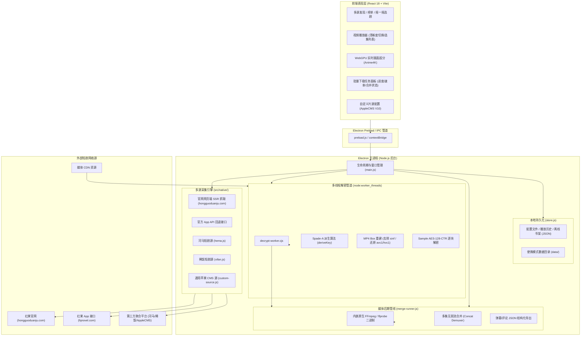
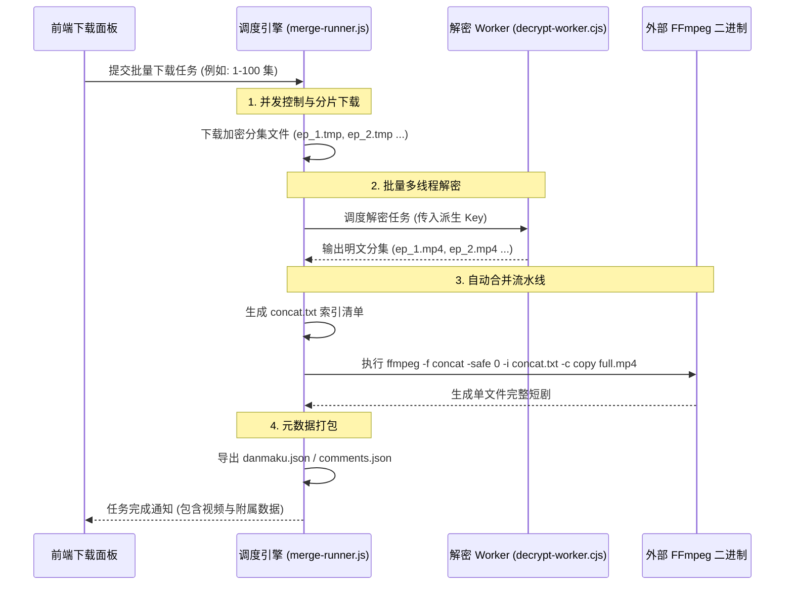

# 红果短剧桌面版 (jackotom / hongguo-drama) 架构与设计分析

> **核对提示（2026-10-27）**：本文是研究笔记，部分表述需要按实际源码和版本复核。已检查的开源源码中 `playback-device.js` 实现了匿名设备注册，`app-source.js` 包含请求处理与签名相关代码；因此“没有设备注册”“App 回退仅使用静态参数”等说法不适合作为设计事实。`decryptMp4File` 使用 `readFileSync` 整文件读入内存，不能据此称文件处理已流式化。官网可播范围、性能和稳定性也不能由单个版本或样本推广到所有剧集。请以 [产品设计与技术架构](产品设计与技术架构.md) 中的验证范围为准。

> 本文档为参考架构解析文档，梳理了开源项目 [`jackotom/hongguo-drama`](https://github.com/jackotom/hongguo-drama)（前身为 `hongguo-downloader`，GPL-3.0 协议）的架构设计、多片源策略及媒体处理机制，作为本项目设计与技术选型的参考资料。

---

## 1. 产品概述与核心定位

* **应用标识**：`io.github.jackotom.hongguo-drama-mac`（原工程名 `hongguo-downloader`）
* **底层开发语言**：JavaScript / Node.js (>=22.12) + React 18
* **桌面框架**：Electron 44.9 + Vite
* **开源协议**：GPL-3.0（源码完全开源）
* **产品核心定位**：**全功能“播放器 + 批量下载器 + 多片源聚合器”**。
  * **播放与下载并重**：不仅能在线免登录看剧，更主打强大的批量全集下载能力；
  * **一键合并长视频**：内置 FFmpeg 工具链，下载完几十至上百集短剧后，可一键无损自动拼接合并为单个完整的 MP4 电影文件；
  * **多数据源聚合**：不局限于红果短剧，还原生聚合了河马短剧、稀饭短剧以及第三方站标准的 AppleCMS V10 接口；
  * **WebGPU 画面超分**：内置 Anime4K 算法引擎，在配备现代 GPU 的电脑上实现短剧与动漫的实时画质增强与超分辨率重建；
  * **媒体元数据完整导出**：支持在下载视频的同时，随片导出弹幕、剧评与分集评论的 JSON 结构化数据，适合离线收藏。

---

## 2. 软件全景架构与技术选型

### 2.1 全景架构拓扑



### 2.2 技术选型清单

| 模块分层 | 选型技术 / 库 | 选型原因与设计权衡 |
| :--- | :--- | :--- |
| **桌面宿主框架** | **Electron (`v44.9.1`)** | 拥有完整的 Node.js 生态，能够自由调度文件系统、子进程、Worker 线程以及外部二进制工具。 |
| **前端开发框架** | **React 18 + Vite** | 组件化架构清晰，便于组织复杂的下载队列表格、多源切换器与播放器状态。 |
| **画面实时增强** | **`anime4k-webgpu` (`v1.0.0`)** | 借助浏览器的 WebGPU 特性，直接在着色器层实现线条锐化和画质超分，不给 CPU 带来解码压力。 |
| **外部媒体处理** | **预打包 FFmpeg / ffprobe 二进制** | 将官方编译好的 macOS/Windows 原生可执行文件打包到应用 `bin/` 目录，彻底摆脱用户本地环境依赖，实现跨平台无缝合并转码。 |
| **多线程加解密** | **`node:worker_threads`** | 将大体积视频文件的解析、Box 重建和 AES-CTR 循环解密迁移至独立线程，杜绝主进程与 UI 界面卡死。 |
| **本地数据管理** | **本地 JSON 扁平化存储** | 设计精简，支持便携模式（Portable Mode，设置与数据全部收拢在程序同级 `data/` 目录）。 |

---

## 3. 数据采集与多片源聚合体系

该项目最精妙的设计在于**规避复杂的风控对抗**，并采用**多源聚合**拓展可用剧目。

### 3.1 红果短剧：双轨制采集策略 (`src/native/hongguo.js`)

在获取红果数据源时，作者采用社区开源实践中的**双轨制**策略：

```
                    ┌── 抓取短剧元数据与播放源 ──┐
                    │                          │
              【首选推荐路径】            【次选回退路径】
                    │                          │
                    ▼                          ▼
          【官网网页端 SSR 抓取】        【App API 静态参数请求】
          - 域名: hongguoduanju.com     - 域名: fqnovel.com
          - 免登录、免设备签名          - 携带固定公共机型 Query
          - HTML 内直接提取完整剧集      - 偶发遇到风控拦截时重试
```

#### 优先：官网网页版 SSR 抓取
* **代码依据**：
  ```javascript
  // ===== 优先使用官网网页版，App 接口保留为回退 =====
  // 官网 player 页是服务端渲染的：完整分集 vid 列表与可直接下载的 MP4 直链
  // 都内嵌在 HTML 里，无需任何签名。走的是官网对普通用户开放的同一层。
  const SITE_ORIGIN = "https://hongguoduanju.com";
  ```
* **优势**：
  * 红果官网的播放器页面是 SSR（服务端渲染），分集的视频 ID、分集名称及直链数据直接注入在 HTML 中；
  * **完全无需任何设备注册与 X-Gorgon 签名计算**，以普通 Chrome 浏览器的 User-Agent 即可顺畅抓取，稳定性极高且极不易被风控。

#### 回退：官方 App API 请求
* 当网页端缺少某些剧集或失效时，回退调用官方 App 接口：
  * 请求域名：`https://api5-normal-sinfonlineb.fqnovel.com`
  * 模拟机型：三星 Galaxy Note 20 Ultra (`SM-N9860`)，Android 9
  * 携带常规的基础公共 Query（`aid=8662`, `app_name=novelread`, `version_code=71532`）进行单集查询。

### 3.2 丰富的第三方扩展源体系
除了红果短剧外，客户端在 `src/native/` 下内置了多个短剧平台的抓取适配器：
1. **河马短剧 (`hema.js`)**：对接河马短剧平台接口，拓展独家付费/免费短剧资源；
2. **稀饭短剧 (`xifan.js`)**：对接稀饭短剧接口，自动解析其视频流；
3. **AppleCMS V10 标准接口 (`custom-source.js`)**：
   * 支持用户自行添加基于 AppleCMS V10 JSON API 规范的自定义站源；
   * 实现了通用的视频分类映射、关键词搜索与分集解析，使客户端具备了通用影视播放器的底座能力。

---

## 4. 视频解密与多线程处理管线

对于从红果接口拿到的加密 CENC-MP4，客户端利用 Node.js 实现了高吞吐的解密模块。

### 4.1 Spade-A 密钥派生算法实现 (`src/native/hongguo.js`)
项目完整实现了 Spade-A 解密算法，将 32 字符 Hex 密文解析为 AES-128 密钥：

```javascript
function deriveKey(spadeA) {
  if (!spadeA) return null;
  const buf = avBase64Decode(spadeA);
  const L = buf.length;
  if (L < 3) return null;

  // 1. 首三字节异或提取主键种子
  const key0 = buf[0] ^ buf[1] ^ buf[2];
  const x27 = key0 - 0x30;
  const w22 = L - key0 + 0x2f;
  if (x27 < 2 || w22 < 2 || w22 > L - 1) return null;

  const x21 = Buffer.from(buf.subarray(1, 1 + w22));
  let w11 = 0x55, w12 = 0xfa, w10 = 0xeb;

  // 2. 二进制 Popcount 与掩码循环变换
  for (let i = 0; i < x21.length; i++) {
    const w13 = x21[i];
    const pc = i.toString(2).split('1').length - 1; // 统计 1 的个数
    const w14 = (i & 1) === 0 ? w12 : w11;
    if ((i & 1) === 1) w11 = w13; else w12 = w13;
    const w13_xor = w14 ^ x21[i];
    const w14_sub = w10 - pc;
    x21[i] = (w14_sub + w13_xor) & 0xff;
  }

  // 3. 计算有效偏移与长度
  const c0 = x21[0];
  let hval = (0x30 <= c0 && c0 <= 0x39) ? c0 - 0x30 : (0x61 <= c0 && c0 <= 0x7a) ? c0 - 0x57 : null;
  if (hval === null) return null;
  const w9 = w22 - hval;
  if (w9 < 2) return null;

  // 4. 提取 32 字符 Hex 字符串并转为 16 字节 Buffer
  const strA = x21.subarray(1, 1 + w9 - 1).toString('ascii');
  if (strA.length !== 32) return null;
  return Buffer.from(strA, 'hex');
}
```

### 4.2 独立 Worker 线程解密 (`decrypt-worker.cjs`)
视频解密涉及密集的位运算和大内存 Buffer 搬运，若在 Electron 主进程中执行会导致窗口卡死或 IPC 超时。项目通过 `node:worker_threads` 进行隔离：
* **内存版解密 (`decryptMp4Buffer`)**：供在线播放器实时加载未落盘的数据；
* **文件版解密 (`decryptMp4File`)**：供下载管线使用，直接以流方式读取加密 `.mp4` 文件，重构 MP4 头部，执行 AES-128-CTR 解密后落盘为标准 MP4，支持外部取消信号（`AbortSignal`）。

---

## 5. 下载与 FFmpeg 媒体后处理流水线

作为该项目最具特色的功能，其拥有一套工业级强度的**全剧下载与拼接流水线**：



### 5.1 自动内嵌 FFmpeg 机制
* 构建脚本（`scripts/setup-ffmpeg-mac.js`）会在打包时自动从可靠源拉取对应平台的 `ffmpeg` 与 `ffprobe` 二进制（支持 macOS arm64/x64 及 Windows x64）；
* 通过 Electron 打包配置中的 `extraResources`，将可执行程序直接放置于客户端安装目录的 `bin/` 文件夹下，**用户无需在系统安装任何编解码器即可开箱即用**。

### 5.2 极速无损合并 (`merge-runner.js`)
* 下载完成后，调度器自动按集数升序创建合规的 Concat 列表文件；
* 调用 `ffmpeg -f concat -safe 0 -i list.txt -c copy output.mp4`，采用 **Stream Copy（纯流复制）** 模式，无需重新编码音视频；
* 即使上百集的短剧，通常也能在 **数秒至十几秒内** 完成无损拼接合并。

---

## 6. 播放器与 WebGPU 画面超分增强

### 6.1 原生播放架构
在线播放采用标准的 HTML5 `<video>` 容器。对于网页抓取到的明文 MP4 或通过本地解密缓冲出的 MP4，直接交由 Chromium 内核进行播放渲染。

### 6.2 Anime4K WebGPU 画面实时增强 (`src/videoEnhancement.js`)
为了满足高配用户在大屏幕上观看低分辨率短剧（部分短剧仅提供 720p/540p 源）的画质需求，项目引入了 WebGPU 渲染技术：
* **核心组件**：`anime4k-webgpu`；
* **工作机制**：
  * 在 Canvas 上建立 WebGPU 上下文；
  * 将 `<video>` 的播放画面作为纹理实时输入给 WebGPU 管线；
  * 运行 Anime4K 的着色器内核，执行自适应线条重构、噪点抑制、细节边缘增强及双线性插值超分；
  * 将锐化增强后的画面以 60 FPS 刷新渲染输出，显著改善画面的模糊感和压缩瑕疵。

---

## 7. 本地数据与便携模式管理 (`src/store.js`)

数据存储未引入重量级数据库引擎，而是采用极简的 JSON 文件系统管理：
* **数据存储项**：收藏夹短剧列表、播放历史（精确记录短剧 ID、集数与进度秒数）、用户自定义快捷键、自定义片源配置。
* **便携模式（Portable Mode）**：
  * 专为 Windows 打造免安装便携版；
  * 检测程序所在目录下是否存在 `data/` 文件夹；
  * 若存在，则将所有的用户缓存、下载临时分片和配置文件重定向到本地 `data/` 目录，随 U 盘即插即拔，不污染宿主系统。

---

## 8. 设计评析与参考借鉴价值

### 核心优势
1. **完全开源透明**：源码采用 GPL-3.0 完全公开，社区协作活跃，代码结构模块化极高。
2. **免签名抓取策略极其实用**：通过优先走官网 SSR 网页解析，巧妙避开了字节跳动频繁升级的移动端加解密风控（X-Gorgon 等），大幅降低了维护成本。
3. **媒体后期与多片源整合极强**：具备完善的下载、解密、FFmpeg 自动拼接合并流水线，且支持多短剧源与 AppleCMS V10，实用价值极高。
4. **画质超分先锋尝试**：利用现代浏览器的 WebGPU 引入 Anime4K 算法，有效提升了短剧在大屏幕上的播放质感。

### 潜在短板与局限
1. **体积与资源占用较大**：基于 Electron 开发并内置了完整的 FFmpeg 二进制，桌面应用体积（~150MB+）和运行内存消耗明显高于 Wails (Go) 架构。
2. **缺乏官方账号深度集成**：由于未实现官方设备注册与短信认证接口，不支持使用手机号同步移动端红果短剧的书架和历史记录。
