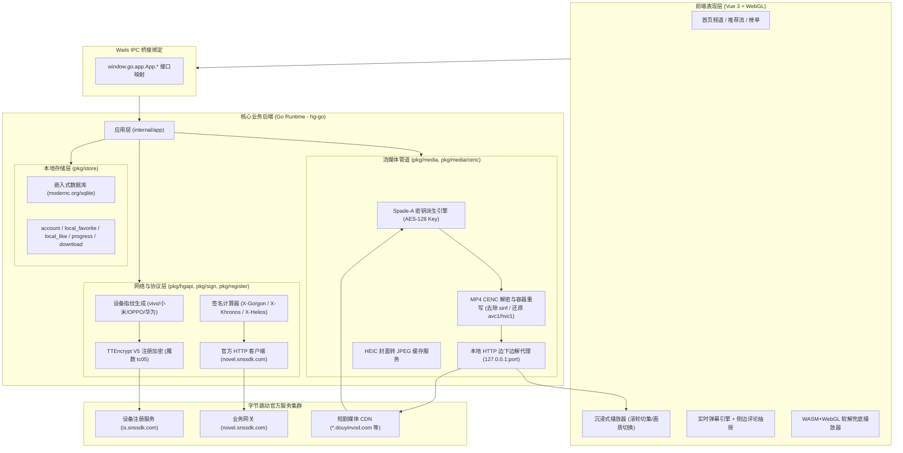
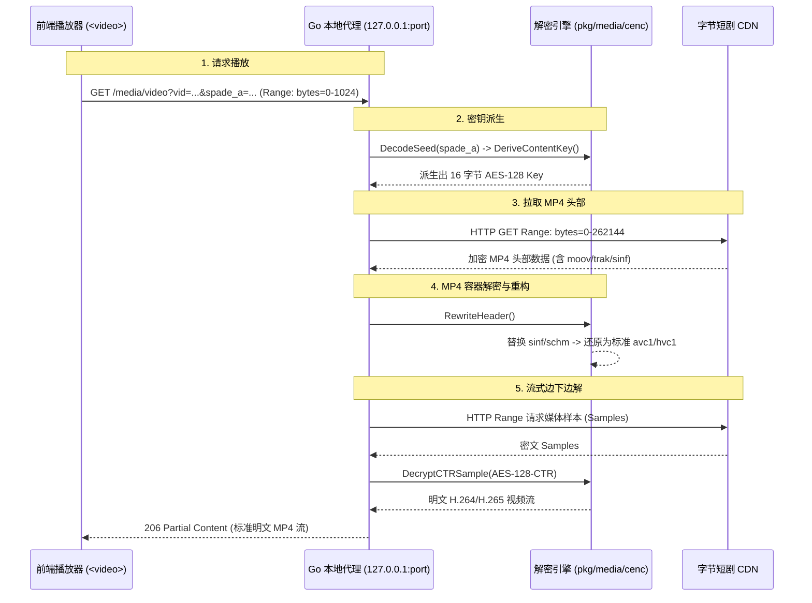

# 红果短剧电脑版 (yangbin1322 / hgplayer) 架构与设计分析

> **核对提示（2026-10-27）**：该项目的发行仓库未公开核心源码。本文包含基于二进制符号、字符串和功能现象的推断；图中的调用顺序、接口参数、算法细节以及软解实现不应视为已由源码或运行时逐项验证。性能百分比、100% 兼容等说法也没有对照测试支持。我们的已验证范围见 [产品设计与技术架构](产品设计与技术架构.md)。

> 本文档为参考架构解析文档，梳理了第三方客户端 `hongguo-player` (hgplayer) 的功能机制与设计特征，作为本项目架构选型与功能设计的参考资料。

---

## 1. 产品概述与核心定位

* **应用标识**：`com.wails.hgplayer`
* **底层开发语言**：Go (1.25) + Web 前端 (Vue 3)
* **发布形态**：macOS Universal Binary (x86_64 + arm64) 单一可执行程序，体积约 49 MB；同时支持 Windows x64。
* **产品核心定位**：**极致轻量的原生电脑端“沉浸式刷剧播放器”**。
  * **免模拟器**：无需安装庞大笨重的安卓模拟器，在 PC 端直接获得手机端短剧体验；
  * **交互对齐移动端与抖音网页版**：竖屏模式无黑边、支持鼠标滚轮与键盘上下键快速切集、自动连播与下一集秒级无感预加载；
  * **办公摸鱼特性**：支持置顶小窗（画中画模式）与“防窥隐身模式”（鼠标移出窗口自动暂停并半透明隐藏）；
  * **官方生态闭环**：完全支持免登录本地刷剧，同时支持官方手机短信验证码登录，双向同步移动端书架、收藏、点赞及播放进度。

---

## 2. 软件全景架构与技术选型

### 2.1 全景架构拓扑



### 2.2 技术选型清单

| 模块分层 | 选型技术 / 库 | 选型原因与设计权衡 |
| :--- | :--- | :--- |
| **桌面宿主框架** | **Wails v2 (`v2.11.0`)** | 相比 Electron 内存占用降低 70% 以上，打包体积控制在 50MB 以内；Go 与 Web 强类型绑定高效简洁。 |
| **前端开发框架** | **Vue 3 + Vite** | 响应式状态管理适合短剧列表切换、弹幕实时流动与进度管理；构建产物直接被 Go `//go:embed` 打包。 |
| **本地数据库** | **`modernc.org/sqlite` (`v1.59.0`)** | 纯 Go 编写的 SQLite 驱动，无需配置任何 CGO 动态依赖环境，跨平台（macOS/Windows）编译零障碍。 |
| **图片解码转码** | **`github.com/gen2brain/heic` (`v0.7.2`)** | 字节服务端海报大量使用 HEIC 高压缩格式，部分桌面 WebKit 无法原生渲染，由 Go 代理服务在内存中动态转为 JPEG。 |
| **WASM 运行时** | **`github.com/tetratelabs/wazero` (`v1.12.0`)** | 纯 Go WebAssembly 运行时，用于在特定系统环境下无依赖执行解码或加解密计算。 |
| **软解播放兜底** | **WebAssembly (`hevcdec.wasm`) + WebGL** | 解决老旧 Windows（无系统 HEVC 扩展）下播放 H.265 短剧黑屏有声音的兼容性顽疾。 |

---

## 3. 设备模拟与风控签名体系

该参考项目并非简单的网页抓取，而是参考开源实现模拟了移动端客户端的通信流程与运行生命周期。

### 3.1 客户端身份参数
* **App ID (`aid`)**：`8662`（红果免费短剧官方 App ID）
* **应用标识 (`app_name`)**：`novelread`
* **版本代码**：`version_code = 73932`，`version_name = 7.3.9.32`
* **系统环境**：`device_platform = android`，`host_abi = arm64-v8a`，`resolution = 1080*2190`

### 3.2 真实硬件指纹池 (`pkg/device/profile.go`)
为了规避服务端针对固定 UA/指纹的风控封禁，应用内置了国产主流机型的完整参数模板：
* **支持品牌**：vivo X100 (`PD2309A`)、Xiaomi 14/13、OPPO Find X7、HONOR Magic 6 Pro、HUAWEI Mate 60 Pro、OnePlus 12。
* **参数生成**：随机生成符合硬件特征的 `openudid`、`clientudid`、`cdid`、`mac`、`dpi` 与 Android ROM 构建指纹。

### 3.3 设备注册流程与 TTEncrypt V5 (`pkg/register`, `pkg/crypto/ttencrypt.go`)
新客户端首次启动无需用户操作，后台自动完成静默设备注册：
1. **注册请求地址**：`https://is.snssdk.com/service/2/device_register/`
2. **TTEncrypt V5 加密保护**：
   * 注册请求 Body 包含完整的系统软硬件特征，字节服务端要求必须经由私有算法加密；
   * 加密协议包含专属魔数头部 `tc05`；
   * 数据体经过 Gzip 压缩后，采用带派生密钥的 AES-CBC 模式加密；
3. **换取设备凭证**：服务端校验合法后，下发正式的 `device_id` 和 `install_id`，持久化写入本地 SQLite。

### 3.4 动态请求签名器 (`pkg/sign`, `pkg/crypto/gorgon.go`)
对所有向 `novel.snssdk.com` 发起的 API 请求，在内存中动态计算字节跳动标准安全请求头：

```
Client Request -> [ Query Params + Body Hash ]
                        │
                        ▼
                X-SS-Stub: MD5(Body)
                X-Khronos: UnixTimestamp()
                X-SS-Req-Ticket: UnixTimestampMs()
                X-Gorgon: RC4变种 + 位反转(reverseBits) + 移位混淆(ror/rol)
                X-Helios / X-Medusa / X-Ladon / X-Argus: 安全追踪指纹
                        │
                        ▼
            发送至字节业务网关 (通过风控校验)
```

---

## 4. 核心 API 体系与接口映射

### 4.1 官方服务端接口清单 (`pkg/hgapi`)

| 业务分类 | API 路由 | 功能描述 |
| :--- | :--- | :--- |
| **发现与频道** | `/reading/bookapi/bookmall/tab/v` | 首页频道 Tab 栏目与配置 |
| **剧场推荐流** | `/reading/bookapi/bookmall/cell/change/v1/` | “换一批”推荐短剧卡片 |
| **分类与榜单** | `/reading/distribution/category/landpage/v1/` | 热度榜、新剧榜、按题材与完结状态筛选 |
| **搜索系统** | `/reading/bookapi/search/tab/v`<br>`/reading/bookapi/search/suggest/v` | 短剧关键词全量检索与输入框实时联想 |
| **视频播放源** | `/novel/player/video_detail/v1/` | 获取单集清晰度列表（360p-1080p）、视频直链与加密字段 |
| **多集批量预取**| `/novel/player/multi_video_model/v1/` | 批量换取后续集数元数据，保证切集零卡顿 |
| **播放进度同步**| `/reading/bookapi/read_progress/upload/v` | 播放秒数与已看完状态上报 |
| **追剧与书架** | `/reading/bookapi/bookshelf/video/list/v`<br>`/reading/bookapi/bookshelf/video/update/v` | 云端追剧列表拉取与更新 |
| **社交互动** | `/novel/commentapi/comment/list/`<br>`/novel/commentapi/comment/add/v1/` | 获取弹幕与剧评、发表评论与点赞 |
| **账号登录** | `/passport/mobile/send_code/v1/`<br>`/passport/mobile/sms_login/` | 手机短信验证码发送与登录换取 Session |

### 4.2 前后端 IPC 桥接接口 (`internal/app/app.go`)
Go 后端通过 Wails 将完整的业务能力暴露给前端 Vue：
* **视频与播放**：`PlayInfo()`, `PrefetchPlay()`, `PrefetchPlayItems()`, `SaveProgress()`, `SetPlaybackPrefs()`
* **内容浏览**：`FeedCategories()`, `Category()`, `RecommendTab()`, `Rank()`, `NewSeries()`, `Related()`
* **搜索**：`Search()`, `SearchSuggest()`
* **互动评论**：`Danmaku()`, `SendDanmaku()`, `LikeDanmaku()`, `Comments()`, `SendComment()`, `LikeComment()`
* **下载管理**：`Downloads()`, `DownloadSeries()`, `AddDownloads()`, `PauseDownloads()`, `ResumeDownloads()`
* **解码与系统控制**：`HEVCStatus()`, `NativeDecOpen()`, `KeepAwake()`, `SetWindowMode()`, `StealthStart()`

---

## 5. 流媒体解密管道与边下边解代理 (CENC & Spade)

短剧流普遍采用 ISO/IEC 23001-7 CENC (Common Encryption) 标准保护，流媒体解密流水线是本项目流媒体播放处理的核心技术点。



### 5.1 Spade-A 密钥派生算法机制 (`cenc/spade.go`)
1. 接口返回的 `encrypt_info` 包含 `kid`、`encryption_method` 与 `spade_a`（Base64 字符串）；
2. 后端执行变种 Base64 解码；
3. 取解码数据首部 3 字节进行异或运算作为初级种子；
4. 遍历密文字节流，利用二进制 `popcount`（置位 1 计数器）计算动态偏移量，结合字节加减与移位混淆运算更新状态；
5. 计算出 **32 个字符的十六进制文本**（若非合法 hex 则报错 `cenc: spade_a 派生结果不是 hex`）；
6. 将十六进制转换为 **16 字节的二进制密钥**（`cipher.NewCipher(key)`），用于 AES 解密。

### 5.2 本地 HTTP 代理与 MP4 容器重构 (`pkg/media/proxy.go`)
前端播放器不直接请求 CDN 链接，而是请求 Go 本地随机端口 HTTP 代理：
* **MP4 头部重构 (`replaceSinf`, `replaceFourCC`)**：
  * 加密视频的 `moov.trak.mdia.minf.stbl.stsd` 中，视频格式会被标记为受保护的 `encv` 或 `enca`，内部嵌套 `sinf` 盒子；
  * 代理服务实时拦截并移除 `sinf` 盒子，将 FourCC 替换回原生未加密的 `avc1` (H.264) 或 `hvc1` (H.265)；
* **流式 Range 实时解密**：
  * 播放器发起拖拽进度、Seek 时，代理将请求范围按 MP4 Sample Offset 对齐，向 CDN 请求分片；
  * 收到分片后以 **AES-128-CTR** 模式在内存缓冲区实时解密 Sample，并以 HTTP `206 Partial Content` 吐还给前端；
  * 整个解密过程完全在流式传输中完成，**无需在本地写入临时解密文件，极度节省磁盘寿命与存储空间**。

---

## 6. 双引擎播放器架构：原生硬解 + WASM 软解

针对 Windows 与老旧 macOS 经常因缺少 HEVC 系统解码扩展导致“黑屏有声音”的问题，该产品设计了**双引擎自适应架构**：

```
                     ┌── 能否硬解 HEVC? ──┐
                     │                   │
                【可以硬解】          【缺少硬解驱动】
                     │                   │
                     ▼                   ▼
           【原生 HTML5 <video>】   【软解兜底流水线】
           - 系统 GPU 硬件加速       - WebWorker (worker.8ac2c3c0.js)
           - CPU/内存占用极低        - WebAssembly (hevcdec.wasm)
           - 4K/1080p 超流畅播放     - WebGL 片段着色器绘制 Canvas
```

1. **引擎 1（默认）：HTML5 原生视频播放**
   * 本地代理服务吐出的是已经去除加密盒的标准 MP4 流，支持硬解的设备（Apple Silicon Mac、安装了 HEVC 扩展的 Windows）直接硬解渲染。
2. **引擎 2（降级）：WebWorker + WASM + WebGL 软解**
   * `worker.8ac2c3c0.js`：在独立线程内执行 MP4 盒模型解析并按 NALU 切分帧；
   * `hevcdec.e298f353.wasm`：通过 WebAssembly 执行 H.265 软解码（基于 ffmpeg/libde265 编译），输出 YUV420p 像素流；
   * `index.df4b21b5.js`：主线程使用 WebGL Fragment Shader 将 YUV 纹理通过可编程管线直接绘制到 HTML5 `<canvas>`，实现 100% 跨平台零驱动黑屏兜底。

---

## 7. 本地数据库与状态模型 (`pkg/store`)

采用嵌入式 Pure-Go SQLite（`modernc.org/sqlite`），所有离线状态均保存在本地：

```sql
-- 1. 账号与登录凭证表
CREATE TABLE IF NOT EXISTS account (
    id         INTEGER PRIMARY KEY,
    device     TEXT NOT NULL,    -- 设备硬件参数与指纹
    cookies    TEXT NOT NULL,    -- 官方会话 Cookie
    token      TEXT NOT NULL,    -- x-tt-token 等鉴权 Token
    profile    TEXT NOT NULL,    -- 用户昵称、头像元数据
    updated_at INTEGER NOT NULL
);

-- 2. 播放进度表 (记忆播放)
CREATE TABLE IF NOT EXISTS progress (
    series_id     TEXT PRIMARY KEY,
    series        TEXT NOT NULL, -- 短剧名称及元数据
    episode_index INTEGER NOT NULL, -- 播放集数
    video_id      TEXT NOT NULL, -- 播放视频 ID
    position_sec  REAL NOT NULL, -- 播放秒数 (支持浮点秒)
    updated_at    INTEGER NOT NULL
);

-- 3. 本地收藏表
CREATE TABLE IF NOT EXISTS local_favorite (
    series_id  TEXT PRIMARY KEY,
    series     TEXT NOT NULL,
    synced     INTEGER NOT NULL DEFAULT 0, -- 是否已同步至云端
    updated_at INTEGER NOT NULL
);

-- 4. 本地点赞表
CREATE TABLE IF NOT EXISTS local_like (
    video_id      TEXT PRIMARY KEY,
    series_id     TEXT NOT NULL,
    episode_index INTEGER NOT NULL,
    series        TEXT NOT NULL,
    synced        INTEGER NOT NULL DEFAULT 0,
    updated_at    INTEGER NOT NULL
);

-- 5. 离线缓存下载管理表
CREATE TABLE IF NOT EXISTS download (
    id         TEXT PRIMARY KEY,
    task       TEXT NOT NULL, -- 下载任务状态 (进度、分片)
    path       TEXT NOT NULL, -- 存储路径
    updated_at INTEGER NOT NULL
);
```

---

## 8. 设计评析与参考借鉴价值

### 核心优势
1. **体积与性能控制极佳**：Wails 编译出来的单文件可执行文件仅 ~49MB，相较于动辄 200MB 的 Electron 客户端在老旧电脑上具有无可比拟的启动速度和内存优势。
2. **流式解密极其优雅**：采用本地 HTTP 代理 Range 拦截，做到“即播即解、不落盘、不占硬盘缓存”，体验极其丝滑。
3. **软解兜底工程度高**：通过 WASM + WebGL 彻底规避了 Windows WebView2 常见的 H.265 黑屏痛点。
4. **官方生态还原完整**：内置完备的设备注册与动态签名器，使客户端能够无缝接入官方登录与弹幕互动。

### 潜在风险与不足
1. **接口签名维护成本高**：服务端的 X-Gorgon / X-Helios 等风控算法若后续大版本升级，参考开源实现的请求签名逻辑可能面临失效，需要持续跟踪维护。
2. **源码闭源**：虽然作者将项目挂在 GitHub，但仓库仅放置了说明与发布包，实际 Go 核心代码并未开源。
