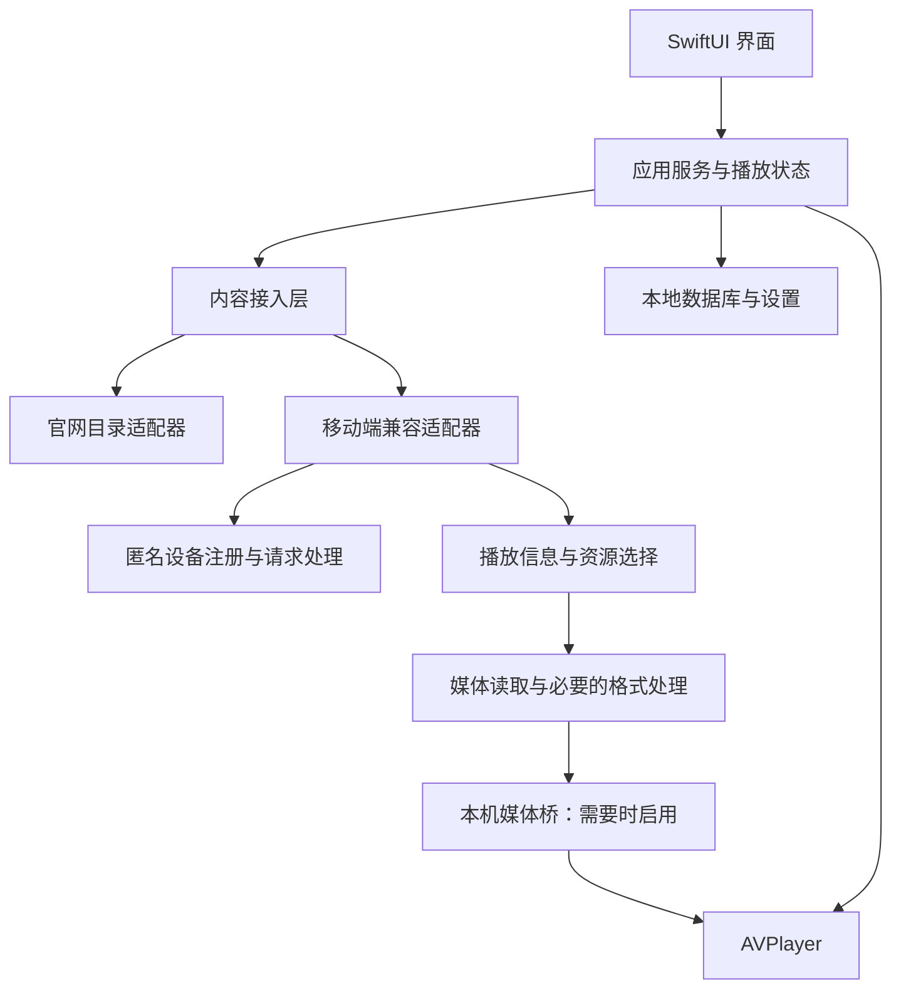

# 红果短剧 macOS 客户端：产品设计与技术架构

状态：方案设计，尚未开始产品实现
更新日期：2026-10-27

本方案参考了 [开源桌面客户端 (hongguo-drama) 架构分析](hongguo-drama-architecture.md) 与 [macOS 客户端 (hongguo-player) 架构分析](hongguo-player-architecture.md)。具体以本文的验证结果和当前项目的独立实现为准。

## 1. 产品目标

提供适合 macOS 使用的短剧观看体验：用户可以搜索红果剧目、选择剧集、连续播放，并在下次打开时接着观看。优先面向个人使用，支持 Apple 芯片与 Intel Mac。

产品使用移动端兼容的内容接入方式，不要求用户运行 Android 模拟器或连接手机。红果官网是可选的内容发现来源；官网开放的播放范围可能小于 App 来源，不能作为完整剧集播放的唯一依据。

本项目不是红果官方客户端。实际内容可用性取决于来源、网络和平台策略；技术可行不等于已经取得接口或内容分发授权。

## 2. 产品范围

### 首个可用版本

- 通过关键词搜索剧目，或粘贴红果剧目链接打开详情。
- 显示封面、简介、总集数、剧集列表及当前播放状态。
- 在线播放、暂停、拖动进度、音量和全屏；支持上一集、下一集与自动连播。
- 提供键盘快捷键和竖屏友好的窗口布局；切集时保留播放上下文。
- 保存本地观看历史和进度，重新打开时恢复；播放失败时提供明确原因及重试。
- 不要求登录；默认不读取或复用手机上的账号、设备标识和观看记录。

### 后续考虑

收藏、排行榜、分类、清晰度切换、预加载、小窗、画中画、分享、账号同步和离线下载。它们不属于首个版本的验收范围；涉及账号或下载的功能需单独确认来源支持、授权和数据管理方式。

## 3. 用户流程

1. 用户搜索剧名或粘贴链接，应用显示匹配的剧目。
2. 用户进入详情页并选择一集；已有进度时可选择继续观看。
3. 应用向内容接入层请求该集的播放信息，再选择设备支持的媒体格式。
4. 播放器加载视频；播放结束后，自动进入下一集，并保存进度。
5. 当资源过期或请求失败时，应用提示实际状态并提供重试，不无限循环请求。

## 4. 架构思路



### 界面与播放状态

首选 SwiftUI 实现搜索、详情、选集和观看界面；AVPlayer 作为首选播放引擎。播放状态统一管理加载、播放、暂停、跳转、完成和失败，避免切集时旧请求覆盖新状态。SwiftUI 和 AVPlayer 是技术选型，尚未在本项目中完成实机验证。

参考项目分别采用 Electron 和 Wails，但它们的体积或内存优势没有在本机做可比基准测试。我们优先验证 SwiftUI + AVPlayer 的用户体验与兼容性，再决定是否需要引入额外播放器或独立后台进程；不把参考项目的软解或 WebGPU 增强直接纳入首版。

### 内容接入

通过统一接口区分剧目搜索、详情、剧集列表和播放资源查询。官网适配器可用于公开的目录信息；移动端兼容适配器负责测试中已证实的 App 来源播放路径。各来源返回统一的数据模型，页面不依赖来源特有字段。来源不可用时显示实际错误，不承诺自动取得其他来源的同名剧集。

具体路由按能力和目标分集决定：目录优先使用可用的官网数据；播放先尝试该来源明确开放且与目标分集匹配的资源，缺失、受限或不兼容时再尝试移动端适配器。带来源的剧目 ID 与分集 ID 必须精确对应，不能按标题或集号猜测替换；受限与技术故障分开记录，禁止把其他集当作目标集。该策略是设计假设，需对网页字段变化和权限状态进行实际验证。

推荐领域模型：

- `Series`：来源、剧目 ID、标题、封面、简介、总集数。
- `Episode`：所属剧目、分集 ID、集号、标题、可用状态。
- `PlaybackSource`：来源、格式、编码、清晰度、有效期及播放所需的临时信息。
- `WatchProgress`：来源、剧目 ID、分集 ID、播放位置、更新时间。

剧目和分集 ID 按字符串存储，避免大整数精度损失；媒体地址、密钥或设备凭据不写入普通业务模型和日志。

### 设备与请求

移动端适配器生成随机的匿名设备配置，执行必要的设备注册，并管理请求中需要的参数与签名。设备状态以应用私有方式保存，避免每次播放都注册新设备；注册失败、请求超时和上游拒绝应区分处理。限制并发和重试次数，避免频繁请求。

模拟的是客户端通信行为，而不是运行 Android 系统。协议细节是非官方实现，可能随上游变化；版本、设备配置与签名应集中管理，不散落在界面代码中。

### 媒体与播放

播放资源解析后，按实际支持情况选择编码及清晰度；处理主备资源、地址失效和取消请求。媒体可能是普通视频，也可能需要额外处理；根据资源元数据和实际格式决定路径，而不是假设所有剧集相同。

优先验证 AVPlayer 能否消费处理后的媒体。若需要本地桥接，在本机提供具备 `Range` 支持的临时媒体服务，仅监听 `127.0.0.1`，使用随机、短期有效的路径；正确处理长度、并发、拖动、取消和结束时的资源清理。优先流式处理并设置内存及缓存上限，不以保存完整视频作为播放前提。

两份分析提示我们应把“处理正确”和“流式高效”分开验收：本次验证所用的开源文件处理实现会整文件读入内存，不能证明 Range 流式处理已经可用。原 App 的相关符号支持本地代理和按范围处理的推断，但未做运行时确认。原型可以对有限大小的测试样本先验证完整处理和 AVPlayer；产品阶段再验证分段读取、样本边界、响应区间、取消与内存上限，不把整集缓冲伪装成流式实现。

媒体处理与下载、合并、画质增强解耦；首版不依赖 FFmpeg 随应用分发，也不包含多片源聚合、批量下载或画质增强。若原生解码不兼容，先尝试来源提供的兼容编码，收集可复现样本后再评估软解及其性能和许可。

### 本地数据与隐私

使用 SQLite 保存历史、进度、收藏和少量剧目缓存；设置使用平台常规配置存储。未来若引入账号，凭据使用 Keychain，单独设计登录和退出流程。默认不记录密钥、完整播放地址、设备凭据或详细观看数据；不向第三方服务发送诊断信息，除非用户主动选择。

## 5. 播放链路与失败处理

```text
剧目 ID → 分集 ID → 获取播放模型 → 选择兼容资源
        → 获取媒体 → 必要的本地处理 → AVPlayer → 保存进度
```

- **注册或接口拒绝**：提示内容来源暂不可用，不反复创建匿名设备。
- **资源过期**：重新查询一次播放信息；仍失败时停止并提供重试。
- **网络中断**：停止当前请求，保留进度，允许恢复。
- **编码不兼容**：尝试来源提供的其他兼容编码或清晰度；无可用资源时明确提示。
- **切集或关闭窗口**：取消过期请求、释放播放器和临时媒体资源。
- **受限剧集或缺少授权**：展示来源返回的状态，不把失败伪装成播放成功。

## 6. 现有验证与边界

2026-10-27，以《婆婆装瘫七年，我高调离婚！》为样本：官网数据列出 83 集，标记 3 集可访问；第 4 集网页直接请求返回 404。用户确认此前的第三方 macOS App 可以播放全剧。

使用独立生成的匿名设备信息和开源项目的播放代码，第 1、4 集均取得 App 来源的 1080p HEVC 媒体及加密相关信息。第 4 集经该项目代码处理后，`ffprobe` 识别到 1080×1920 HEVC 视频与 AAC 音频、时长约 152.58 秒；开头与 120 秒处各 10 秒通过 `ffmpeg` 解码检查。测试未读取手机账号或设备标识。

这证明测试时单集内容获取和本地解码链路可行；**尚未验证 AVPlayer、全剧每一集、所有剧目、长期稳定性或发布授权**。更详细的原始记录见 [验证与实现方案](验证与实现方案.md)。

## 7. 实施阶段与验收

1. **播放原型**：固定测试剧和第 4 集，先验证有限样本的 AVPlayer 音画播放、暂停和拖动；再验证本机桥的 Range 和取消。验收覆盖开头、中间、结尾、不同区间与应用退出清理，并记录内存占用。
2. **最小产品**：实现搜索或链接打开、详情、选集、连续播放和进度恢复；分别验证无网络、资源过期、上游拒绝和不支持编码时的提示。
3. **兼容与稳定性**：测试不同剧目、长时间观看、连续切集、内存与缓存上限；分别在 Apple 芯片和 Intel Mac 上验证，明确最低 macOS 版本。
4. **发布准备**：确认协议依赖和可用授权，完成开源许可审查、签名、公证与更新机制。账号同步、下载等扩展功能另行规划。

回归测试使用脱敏的协议样本与本地媒体夹具，覆盖未加密与加密样本、无效模型、源过期、精确分集匹配、短范围和跨样本 Range、连续拖动、取消及上下游错误。少量真实联网验证单独执行，避免测试时反复注册设备或产生批量请求。

## 8. 参考项目和资料

| 项目或资料 | 用途与限制 |
| --- | --- |
| [jackotom/hongguo-drama](https://github.com/jackotom/hongguo-drama) | 开源 macOS/Windows 客户端；本次使用其代码验证匿名设备注册、播放取址与媒体处理。GPL-3.0，直接复用和分发须遵守许可及上游声明。 |
| [匿名设备注册实现](https://github.com/jackotom/hongguo-drama/blob/main/src/native/playback-device.js) | 参考匿名设备参数和注册流程；具体参数依赖上游版本。 |
| [App 来源实现](https://github.com/jackotom/hongguo-drama/blob/main/src/native/app-source.js) | 参考播放模型、资源选择和请求处理；非官方协议。 |
| [媒体处理实现](https://github.com/jackotom/hongguo-drama/blob/main/src/native/hongguo.js) | 参考 MP4 解析与处理；本次使用其 `decryptMp4Buffer` 验证第 4 集。 |
| [zhangbaio/hongguo](https://github.com/zhangbaio/hongguo) | 开源移动端协议与媒体处理研究项目，可作交叉参考；未用于本次实测，复用前需核查许可。 |
| [yangbin1322/hongguo-player](https://github.com/yangbin1322/hongguo-player) | 原第三方 macOS App 的发行仓库，源码未公开；其程序结构和用户验证结果用于需求与可行性参考。 |
| [红果官网样本剧](https://hongguoduanju.com/player/7696091370296970265) | 用于对照网页播放与剧集列表；可访问范围会变化。 |
| [Apple FairPlay Streaming](https://developer.apple.com/streaming/fps/) | Apple 平台受保护媒体的参考资料；目前没有证据表明本样本采用 FairPlay。 |

## 9. 待决问题

- 最终采用独立实现还是基于 GPL 项目开发；直接移植、改编和分发前审查许可证及上游声明。
- 平台是否提供适用的第三方接口、内容播放或分发授权；是否需要账号和相应许可。
- AVPlayer 对实际媒体和本机桥的兼容性，以及最低 macOS 版本。
- 多剧目、多清晰度、长时间播放和地址过期后的稳定性；接口变化后的维护方式。
- 移动端接口支持范围与频率限制；用户可见的受限内容如何准确提示。
- 本仓库的 `LICENSE` 是 AGPL-3.0；参考项目标注 GPL-3.0，直接复用相关代码前需核查具体版本、上游许可、NOTICE、兼容性和分发义务，不能仅凭两者名称推断结论。
